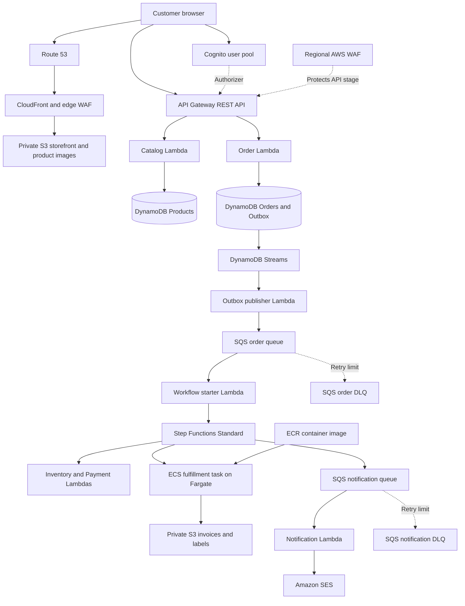
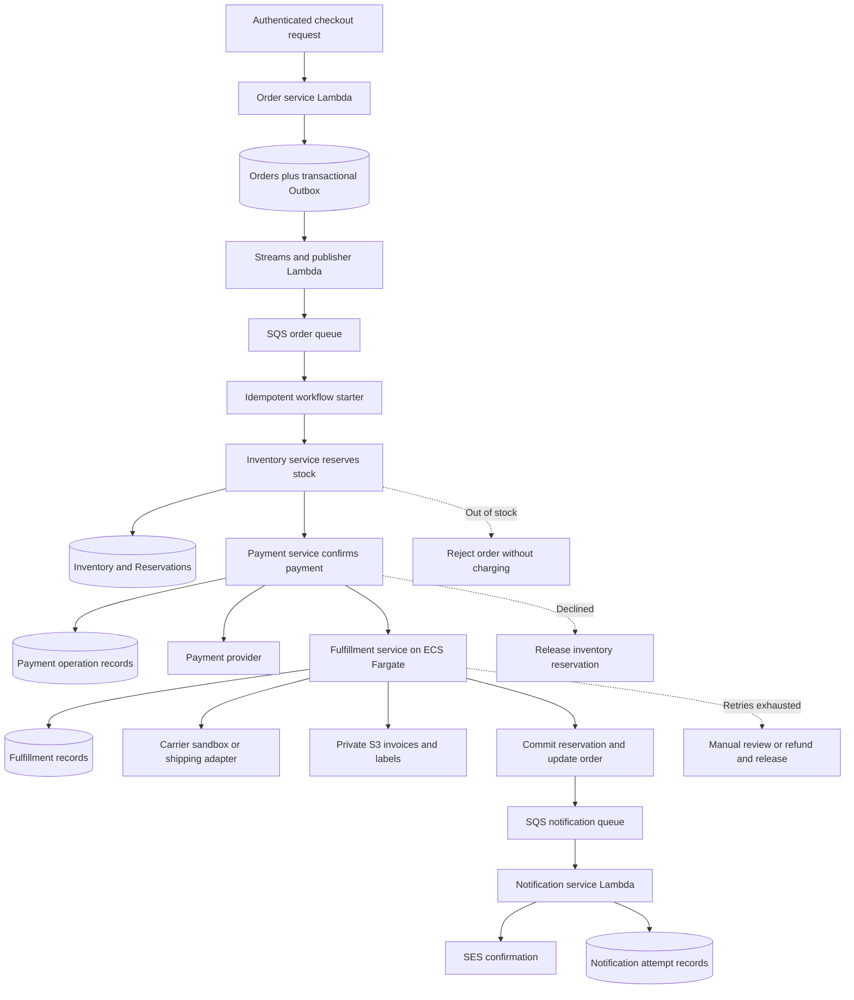
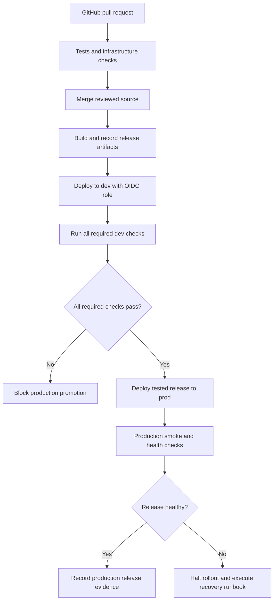

<!-- PitchGear: target AWS project and microservices architecture. Planned, not deployed. -->
# PitchGear — Project and Microservices Architecture

**Purpose:** A soccer equipment e-commerce portfolio project with 20 products, reliable order processing, and separate development and production environments.

**Status:** Target design for implementation from scratch. The existing Sites storefront is a visual prototype, not an AWS deployment. This document supersedes the prototype's single-environment blueprint. The roadmap will follow this architecture.

## 1. Project implementation agreement

- Primary region: **us-west-2 (Oregon)**. Environments: **dev** and **prod**.
- Use Git Bash inside Visual Studio Code. Terminal blocks contain executable Git Bash commands only.
- Provide the exact path and complete contents of each source/configuration file for the user to paste into VS Code. Do not generate source files using terminal heredocs, echo, or similar commands.
- Explain code using `#` comments wherever supported: Terraform, Python, YAML and Bash. Use valid language-specific comments for JavaScript, HTML and other formats. Strict JSON has no comments; provide a commented source representation or explain the JSON outside the file.
- Use production engineering practices appropriate to a small project: least privilege, secrets management, infrastructure as code, automated delivery, idempotency, monitoring, backups and tested recovery.
- Validate each phase before advancing. At its end, provide a GitHub-ready Markdown implementation summary containing completed work, changed files, validation evidence, incidents, limitations and next steps.
- Keep `dev` and `prod` separate. A failed or skipped required dev check blocks production promotion. Promote the tested release artifacts, not a freshly rebuilt application.
- Maintain an honest GitHub portfolio: distinguish designed, implemented and verified capabilities. Use synthetic customer data in examples, tests, screenshots and documentation.

## 2. Project architecture

The following is the workload template. Terraform creates **one isolated copy in dev and one in prod**. Nodes are not shared between environments. CloudFront and Route 53 are global services; CloudFront viewer certificates and CloudFront-scope WAF resources use us-east-1. The regional API certificate and regional API WAF use us-west-2.

**Browser paths:** the storefront uses CloudFront; the API uses its own regional API Gateway endpoint/custom domain. API Gateway does not sit behind the storefront distribution in this design. Regional WAF protects the REST API stage directly, including calls that bypass the storefront. Configure exact-origin CORS, authorization, validation and throttling; CORS is not an authorization control.

**Authentication:** public product reads do not require sign-in. Checkout and order history require a Cognito access token and route scopes. Order Lambda checks the authenticated customer's ownership on every order read. Payment webhooks use provider signature verification instead of customer authentication.

**Container network:** only the Fargate fulfillment tasks require the project VPC. Use private subnets across two availability zones, no inbound access, and explicit outbound connectivity. Production uses resilient egress across the selected zones; development may use a documented lower-cost egress topology. Determine NAT versus endpoint costs during implementation. Lambda services remain outside the VPC unless a private dependency requires otherwise.

**Operations plane:** CloudWatch logs/metrics/alarms, tracing and correlation IDs, IAM service roles, Secrets Manager, encryption, CloudTrail and AWS Budgets apply across the workload. DynamoDB point-in-time recovery, S3 versioning where appropriate, and tested restore procedures protect durable data. These cross-cutting services are omitted from arrows for readability.

## 3. Microservices architecture

This diagram focuses on business boundaries and the successful order path. Each service owns its data. Internal services do not expose unnecessary public APIs. Step Functions coordinates the business workflow without combining the microservices into one large Lambda.

The starter launches a **Step Functions Standard** execution. The reserve, payment, fulfillment, commit and notification-enqueue stages run under that workflow. ECS tasks are launched using `ecs:runTask.sync`; **SQS does not directly invoke ECS**. ECS orchestrates containers; Fargate supplies serverless compute. Fulfillment is a per-order task, not an always-running ECS service.

| Microservice | Runtime | Responsibility | Owned storage |
| --- | --- | --- | --- |
| Catalog | Lambda | List 20 products; categories, variants, trusted prices and product image references | Products table |
| Orders | Lambda | Validate checkout, calculate totals, create order/outbox atomically, return customer order status | Orders table with outbox/idempotency items |
| Inventory | Lambda | Conditionally reserve, commit and release quantities per SKU | Inventory and reservation records |
| Payments | Lambda | Provider sandbox integration, verified webhooks, reconciliation, refunds and operation deduplication | Payment operation records; credentials in Secrets Manager |
| Fulfillment | ECS on Fargate | Create invoice PDF and carrier label; track dispatch preparation | Fulfillment records and private S3 documents |
| Notifications | Lambda | Process queued notifications and send via SES | Notification attempt records |

Publisher, workflow starter and status-update handlers are supporting components. They have narrowly scoped roles. Only the Orders service updates its order records; workflow and fulfillment invoke its internal status operations rather than writing across service boundaries. Data ownership is enforced through IAM and service contracts.

## 4. Order acceptance, processing and recovery

1. Customer browses 20 products and selects quantities and available size/color SKUs. The browser submits identifiers and quantities; the backend recalculates prices, shipping and applicable tax in integer cents.
2. `POST /orders` validates authentication, request shape, product state and a customer-scoped `Idempotency-Key`. Bind the key to a request hash. Commit the order, idempotency record and outbox event in one DynamoDB transaction. Return **202 Accepted** and an order ID. Acceptance is not payment or shipment confirmation.
3. DynamoDB Streams delivers the outbox insertion to Publisher Lambda. It publishes a minimal event to SQS and marks the outbox item published. Filter for outbox insertions, not unrelated order updates. Use a scheduled reconciliation job to find and republish outstanding events; monitor outbox and stream age so failed consumers do not silently lose orders.
4. SQS triggers Starter Lambda. Start a Standard workflow with a stable order-derived execution name and immutable input. Verify duplicate starts correspond to the same order. Delete/acknowledge the message only after durable workflow acceptance. The queue DLQ handles failed handoff; failures after workflow start require workflow recovery.
5. Inventory Lambda atomically reserves all requested SKUs using conditional transactions and an order-specific reservation key. Bound cart size to fit transaction limits. Concurrent purchases must not oversell stock.
6. Payment Lambda charges through the provider's sandbox using a stable operation key. Verify signed webhooks and deduplicate their event IDs. For ambiguous timeouts, reconcile provider state before retrying a charge or releasing inventory.
7. Step Functions launches the fulfillment task on Fargate. The task uses a pinned image digest from ECR, creates S3 documents and prepares a shipment through the shipping adapter. Persist carrier operation keys to prevent duplicate label purchases. Do not mark an order shipped merely because a label exists.
8. After fulfillment preparation, commit the reservation and persist the durable order state. Notification enqueue is retried independently; a reconciliation path repairs any completed order missing its notification intent. Notification Lambda sends through SES.
9. Customer reads the latest durable order state using `GET /orders/{orderId}`. Document downloads require ownership validation and short-lived S3 presigned URLs. A verified carrier handoff updates the order to `SHIPPED`.

| Failure | Required response |
| --- | --- |
| Insufficient stock | Reject order; do not charge |
| Payment declined | Record failure and release reserved inventory once |
| Payment result unknown | Hold for reconciliation; never blindly repeat a charge |
| Fulfillment temporary failure | Retry with bounded backoff and preserve paid state |
| Fulfillment cannot complete | Manual review; controlled cancellation refunds payment and releases stock when shipment has not been committed |
| Duplicate request/message | Return existing result or resume the recorded operation; do not repeat business side effects |
| Failed notification | Retry notification only; do not repeat payment or fulfillment |
| Poison queue message | DLQ, alarm, investigation and controlled redrive |
| Stuck workflow/reservation | Scheduled reconciliation; conditional cleanup after checking payment and shipment state |

SQS delivery is at least once. Configure partial batch responses, queue visibility based on consumer timeout and batching, DLQs and concurrency limits. Idempotency must exist in business operations, not only at the queue. An ambiguous SES send can still produce a duplicate email; do not claim exactly-once delivery. DynamoDB TTL is eventual cleanup, not a precise stock-release scheduler.

## 5. Two-environment architecture

**Isolation target: separate AWS accounts for dev and prod.** Confirm both account IDs during foundation work. Do not silently substitute one account. If only one account is available, document and agree on that reduced isolation before implementation.

| Area | dev | prod |
| --- | --- | --- |
| Resource prefix | `pitchgear-dev` | `pitchgear-prod` |
| Region | us-west-2 | us-west-2 |
| AWS account | Development account | Separate production account |
| Terraform | Separate root configuration/state key and deployment role | Separate root configuration/state key and deployment role |
| State security | Versioned encrypted S3; native S3 lockfile | Separate encrypted state and native S3 lockfile |
| Data | Synthetic catalog, customers, stock and test orders | Independent catalog, stock and customer records |
| Identity | Dedicated Cognito pool/client | Dedicated Cognito pool/client |
| Compute and messaging | Dedicated Lambdas, workflow, ECS resources, SQS and DLQs | Separate equivalents; independent quotas and scaling bounds |
| Secrets | Dev-specific provider credentials | Prod-specific credentials and access policy |
| Payments/shipping | Provider sandbox and test adapter | Production integrations when go-live prerequisites are verified; test mode is explicitly reported until then |
| Delivery | Required tests execute here | Promotion only from a passing dev release |
| Operations | Alarms and validation dashboards | Alarms, recovery protections and operational runbooks |

A custom domain is selected during foundation work; do not assume ownership of `pitchgear.com` or reuse an AVOS domain without agreement. CloudFront default domains can support initial validation. API and identity configuration remain environment-specific.

## 6. Release promotion architecture

- Use a single repository and shared Terraform modules, with separate environment root configurations. Use protected `main`, required PR checks and GitHub `dev`/`prod` environments.
- GitHub Actions uses OIDC and separate environment-scoped AWS roles. Restrict trust to the exact repository and deployment environment; store no long-lived AWS keys in GitHub.
- Build/version Lambda packages and the fulfillment container once. Record the commit, package checksums, frontend bundle checksum and container digest in a release manifest. Copy immutable artifacts between account-owned stores as necessary and verify checksums/digests.
- Keep environment-specific frontend configuration outside the versioned application bundle so promotion does not require rebuilding tested application code. Never include secrets in browser configuration.
- Apply shared Terraform modules with each environment's own variables and newly generated plan. **Never apply a dev Terraform plan to prod.** Keep sensitive plans/artifacts private and short-lived. Review infrastructure changes through the PR and plan checks.
- For initial buildout, deploy each completed milestone to dev and promote only after all checks applicable to that milestone pass. A missing required test is a blocked gate, not a passing gate. Do not call the complete store production-ready until the full end-to-end suite and go-live prerequisites pass.
- Required gates cover unit tests, service contracts, infrastructure validation, security checks, authenticated access/ownership, order success, inventory concurrency, duplicate delivery, payment failure/ambiguity, fulfillment failure, queue recovery and agreed load targets. Configure the exact gates alongside each implemented capability.
- Production smoke tests use synthetic, controlled transactions with defined cleanup. Separate live payment activation from infrastructure readiness. Never run destructive dev failure tests against customer production data.
- Recover using prior immutable application versions and compatible configuration. Use backward-compatible data changes. Do not blindly revert Terraform state, database contents or completed customer transactions.

## 7. Production controls and scope

Required: per-service IAM, encryption and TLS, private buckets, exact-origin CORS, API throttling, two-zone Fargate networking, service-side authorization, payment signature verification, bounded retries, idempotency, audit logs, queue alarms, workflow failure detection, recovery and budget alerts. Keep the catalog at 20 products for this project; expand variants without adding unrelated microservices.

CloudWatch correlates request ID, order ID, event ID and workflow execution ARN. Alarm on API errors/latency, Lambda errors/throttles, SQS age, DLQ messages, stream lag, unpublished outbox age, workflow failures and Fargate task failures. Redact tokens, addresses and secrets; set log retention. Expose alerts through a configured operational notification channel and validate delivery.

No Kubernetes, ALB, EC2 application servers, multi-region active-active system, analytics platform or recommendation engine is required. A single-region design is not a regional disaster-recovery solution; document recovery objectives and evidence without claiming capabilities not implemented.

## 8. Official references

- [AWS: WAF protection for API Gateway REST APIs](https://docs.aws.amazon.com/apigateway/latest/developerguide/apigateway-control-access-aws-waf.html)
- [AWS: Cognito user pool authorizers](https://docs.aws.amazon.com/apigateway/latest/developerguide/apigateway-integrate-with-cognito.html)
- [AWS: Step Functions ECS/Fargate integration](https://docs.aws.amazon.com/step-functions/latest/dg/connect-ecs.html)
- [AWS: Lambda with SQS](https://docs.aws.amazon.com/lambda/latest/dg/with-sqs.html)
- [AWS: transactional outbox pattern](https://docs.aws.amazon.com/prescriptive-guidance/latest/cloud-design-patterns/transactional-outbox.html)
- [AWS: CloudFront certificate requirements](https://docs.aws.amazon.com/AmazonCloudFront/latest/DeveloperGuide/cnames-and-https-requirements.html)
- [HashiCorp: S3 backend and native state locking](https://developer.hashicorp.com/terraform/language/backend/s3)
